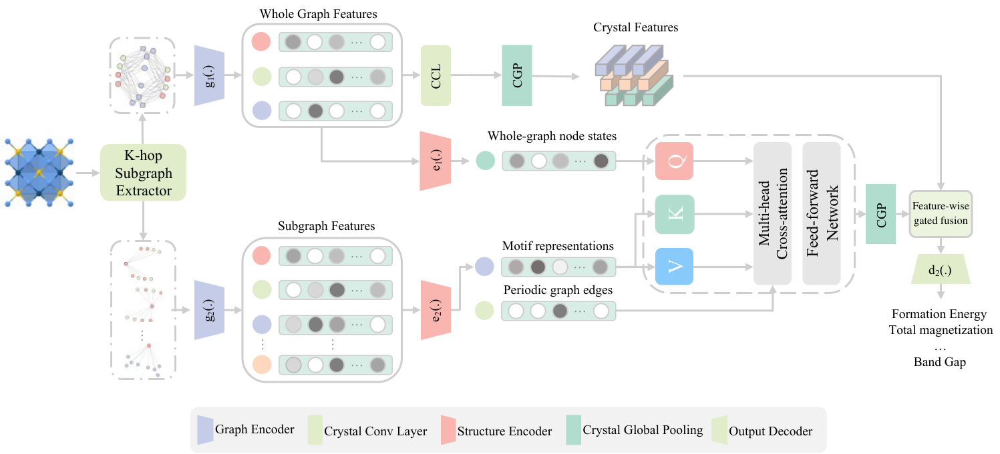

<h1 align="center">SACGT</h1>

<strong>Structure-Aware Crystal Graph Transformer</strong>

  Motif-aware crystal transformers for magnetic-property prediction 
  and interpretation in correlated solids

  <strong>Accepted in <em>npj Computational Materials</em></strong> 
  Materials informatics · Crystal graph learning · Model interpretation

  <a href="#overview">Overview</a> ·
  <a href="#method">Method</a> ·
  <a href="#public-materials">Materials</a> ·
  <a href="#paper-and-citation">Citation</a>

## Overview

**How can a crystal-learning model account for both periodic structure and local motifs when predicting magnetic properties?**

SACGT combines a periodic crystal-convolution pathway with a motif-based attention pathway. The framework learns crystal-level properties from elemental identities and atomic geometry, then uses a separate attribution analysis to examine how structural features contribute to a prediction.

This repository is the public research companion to the accepted paper. It contains selected figures and visualization utilities, not the full model implementation or a reproducibility package.

  

Architecture overview from the revised manuscript. Click the figure for the vector PDF.

The authors assembled the diagram using Visio and PowerPoint. The crystal illustration was obtained from the Materials Project entry [mp-865951](https://next-gen.materialsproject.org/materials/mp-865951).

## Method

1. **Periodic crystal encoding.** A crystal-convolution pathway represents atomic environments and periodic connectivity, producing a crystal-level readout.
2. **Motif-based cross-attention.** Whole-graph node states query representations of site-centered, two-hop subgraphs. In the sparse configuration, attention follows retained periodic graph edges.
3. **Feature-wise fusion.** A learned gate combines the two pooled representations for property prediction. Attribution is performed separately on the trained predictor; it is not an atom-resolved training target.

### What the study examines

- **Predictive performance:** comparisons across crystal-property tasks, with additional magnetic and formation-energy evaluations.
- **Model interpretation:** site-resolved contributions in Ti₂O₃, alongside numerical and perturbation checks that examine their meaning and limitations.
- **Materials screening:** prioritization of two-dimensional magnetic-semiconductor candidates from C2DB and a case study of 1T-CrS₂H.

The comparisons show task- and metric-dependent performance, not uniform superiority over alternative models. The attribution values describe model contributions and should not be read as independently predicted or validated atomic magnetic moments.

## Public materials

| Material | Contents |
|---|---|
| [Architecture figure](assets/figures/main/figure1.pdf) | Revised framework diagram in vector PDF and PNG formats |
| [Figure collection and provenance](docs/FIGURE_INVENTORY.md) | Selected visual results, with version and interpretation notes |
| [Visualization utilities](scripts/README.md) | Colour helpers and PDF-to-PNG rendering |
| [Access and release status](docs/PREPUBLICATION_ACCESS.md) | What is available here and the scope of any future release |

The other figure assets are retained historical previews. They are not a complete set of the accepted paper's figures or supplementary results; see the inventory before reusing their numbering or quantitative annotations.

<strong>Render the included figure PDFs</strong>

From the repository root:

~~~bash
python -m pip install -r requirements.txt
python scripts/render_pdf_previews.py assets/figures/main
python scripts/render_pdf_previews.py assets/figures/supplementary
~~~

This regenerates PNG previews beside the PDFs. It does not run SACGT, reproduce experiments, or calculate attributions.

## Paper and citation

**Motif-aware crystal transformers for magnetic-property prediction and interpretation in correlated solids**

Shilei Ji, Yixuan Wang, Xiaoyang He, Jinlan Wang, Shengjie Zhang, and Li Gao.

Accepted in *npj Computational Materials*. The article is not yet online; its DOI and final bibliographic details will be added when available.

~~~bibtex
@article{ji2026sacgt,
  title   = {Motif-aware crystal transformers for magnetic-property prediction and interpretation in correlated solids},
  author  = {Ji, Shilei and Wang, Yixuan and He, Xiaoyang and Wang, Jinlan and Zhang, Shengjie and Gao, Li},
  journal = {npj Computational Materials},
  year    = {2026},
  note    = {Accepted for publication}
}
~~~

Machine-readable metadata are provided in [CITATION.cff](CITATION.cff). No article DOI or public archival deposit is claimed at this stage.

<strong>Author contributions</strong>

- **Study design:** Shilei Ji, Xiaoyang He, and Yixuan Wang.
- **Data curation, model development and implementation, analyses, results, and manuscript drafting and revision:** Yixuan Wang.
- **First-principles calculations:** Shilei Ji and Xiaoyang He.
- **Technical and funding support:** Shengjie Zhang, Jinlan Wang, and Li Gao.
- All authors reviewed and approved the manuscript.

## Availability and contact

The full implementation, model weights, task datasets, raw predictions, and study-specific DFT outputs are not distributed in this repository. Acceptance does not by itself change these access conditions. Any further release requires author approval and appropriate redistribution rights; no release date is announced.

For questions about the public material, please [open an issue](https://github.com/BaikelWang/sacgt-magnetism-preview/issues). Research or access enquiries should be directed to the corresponding authors through their institutional contact channels; please do not post confidential material in public issues.

The existing [LICENSE](LICENSE) remains in force. This preview should not be treated as an open-source release of SACGT. See the [access policy](docs/PREPUBLICATION_ACCESS.md) and [release status](docs/RELEASE_PLAN.md) for details.
